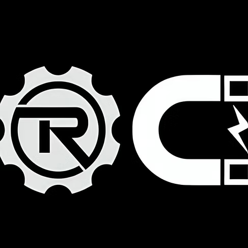

# PartsPal 🤖 — Robotics Club Lab Inventory & Kit Checkout System

<p align="center">
  
  <br>
  <strong>Robotics Club VITC — Lab Operations & Hardware Checkout Portal</strong>
  <br>
  <em>Round 2 Build Task (PS-05 PartsPal - Standard / Robotics)</em>
</p>

<p align="center">
  
  
  
  
</p>

---

## 📌 Problem Statement & App Overview

During hackathons and robotics competition seasons, managing microcontrollers, sensors, motor drivers, and specialized assembled kits (e.g., line-follower kits) is prone to stock discrepancies and long desk queues.

**PartsPal** solves this with an end-to-end management platform tailored for both students and lab organizing committee (OC) leads:

1. **Dual Role Sign In**:
   - **Participants (P)**: Sign in with VIT student email (`xyz.abc2025@vitstudent.ac.in`) & registration number (`25BRS1234`).
   - **OC Leads (OC)**: Protected with secret passcode authentication (`VITCRC123`).
2. **All-or-Nothing Kit Issuing (Core Algorithm)**:
   - When a kit is requested, the server atomically checks available stock across **every individual component**. If even one part is out of stock, the transaction fails safely with an itemized explanation of missing items, preventing partial checkouts and corrupted stock counts.
3. **Dynamic Kit Builder & Part Manager**:
   - OC leads can customize kit recipes dynamically (e.g., adding robotic wheels or motor drivers to a chassis kit) or create new inventory components with immediate live synchronization.
4. **Smart Defective Return & Replacement**:
   - If a participant returns a kit with a damaged component, the OC logs the incident. Undamaged parts return to inventory, total damaged inventory decreases, and a **fresh replacement kit** is issued on the spot under a linked audit ID.
5. **Real-Time QR Scanner & Code Generator**:
   - Instant QR code generation on student request confirmation for phone screen display or printable shelf labels.
   - Built-in **camera-based QR scanner** (`html5-qrcode`) on the OC desk portal for 1-click scan-and-approve checkouts.
6. **Grace Period & Overdue Calculations**:
   - 10-minute grace period with humanized countdown timers (*"Due in 2h"*, *"⏳ In Grace Period (5m left)"*, *"⚠️ Overdue by 25m"*).
7. **Live Stats Bar & Dark/Light Space Theme**:
   - Real-time inventory overview tracking Ready Stock, Active Checkouts, Overdue loans, and Defective logs.
   - Space-glass UI inspired by the Robotics Club mascot with full **🌙 Dark / ☀️ Light / 💻 System** theme switcher.

---

## 🚀 Key Features

### 🎓 Participant Portal
- **Kit & Component Catalog**: Browse complete robotics kits and individual sensors with live stock counters.
- **Local Time Pre-Fill**: Request modal automatically pre-fills with your current device time and presets (`+2 Hours`, `+4 Hours`, `Tomorrow 9:00 AM`).
- **Pickup Codes & Scannable QR Codes**: Generates short codes (`K-XXXX` or `P-XXXX`) and canvas QR codes to show at the lab desk.
- **My Requests Tracking**: Real-time status tracker (*Pending*, *Issued*, *Overdue*) with countdown badges.

### 🛠️ OC Lead Portal
- **Live Lab Stats Bar**: Real-time overview of Available Parts, Active Loans, Overdue Checkouts, and Defective Incident counts.
- **Camera QR Scanner Modal**: Scan participant phone screens directly from laptop webcam or search manually to approve kits in 1 click.
- **Who Has What**: Live loans dashboard displaying borrower details, checkout time, return deadlines, and condition status.
- **Dynamic Kit Customizer**: Add or remove parts from existing kits, create brand-new kits, or add new parts (e.g. `L298N`, `Micro Servo`) directly into lab inventory.
- **Stock Manager**: Adjust owned lab stock as new supplies arrive.
- **Defective Processing**: Record defect notes, decrement broken stock, and automatically issue replacement kits.
- **Member History**: Searchable audit log filtered by registration number showing checkout history and the approving OC member's name.

---

## 🛠️ Tech Stack

| Layer | Technology | Purpose |
|---|---|---|
| **Frontend** | React 19, Vite 8 | Ultra-fast client build and reactive UI |
| **Styling** | Custom CSS3 + Glassmorphism | Space-tech theme, responsive layouts, dark/light modes |
| **QR Engine** | `qrcode`, `html5-qrcode` | Client-side QR generation & camera scanner |
| **Backend** | Node.js, Express | RESTful API server with atomic issuing logic |
| **Data Store** | In-Memory Database (`db.js`) | Fast competition data store pre-seeded with robotics kits |
| **Deployment** | Render (Backend), Vercel (Frontend) | Production cloud deployment |

---

## 🔌 API Reference

| Method | Endpoint | Description |
|---|---|---|
| `POST` | `/api/auth/login` | Authenticate as Participant (`p`) or OC Member (`oc` with passcode) |
| `GET` | `/api/parts` | Fetch inventory with optional search and category filters |
| `POST` | `/api/parts` | Add a new component to lab inventory |
| `PATCH` | `/api/parts/:id` | Adjust total stock counts |
| `GET` | `/api/kits` | Fetch all kits with `canIssueCount` computed on the fly |
| `POST` | `/api/kits` | Create a brand-new robotics kit |
| `PATCH` | `/api/kits/:id` | Modify components and quantities in an existing kit |
| `GET` | `/api/issues` | List checkout issues (supports `?status=` and `?regNo=`) |
| `POST` | `/api/issues` | Submit checkout request (generates pickup code) |
| `POST` | `/api/issues/:id/approve` | Approve checkout with atomic all-or-nothing stock deduction |
| `POST` | `/api/issues/:id/reject` | Reject a pending checkout request |
| `PATCH` | `/api/issues/:id/return` | Standard return (restores non-defective stock) |
| `POST` | `/api/issues/:id/return-defective` | Process damaged return and auto-issue replacement kit |
| `GET` | `/api/health` | Service health check |

---

## 💻 Running Locally

### Prerequisites
- Node.js (v18+)
- npm or yarn

### 1. Clone the Repository
```bash
git clone https://github.com/Swati-web-arch/PartsPal.git
cd PartsPal
```

### 2. Start the Backend Server (Terminal 1)
```bash
cd server
npm install
npm run dev
```
> Server runs on `http://localhost:5000`

### 3. Start the Frontend Client (Terminal 2)
```bash
cd client
npm install
npm run dev
```
> Client runs on `http://localhost:5173`

---

## 🔐 Demo Credentials

| Role | Name | Email ID | Reg No | Passcode |
|---|---|---|---|---|
| **Participant (P)** | `xyz abc` | `xyz.abc2025@vitstudent.ac.in` | `25BRS1234` | *(None required)* |
| **OC Lead (OC)** | `Admin Lead` | `lead.oc2025@vitstudent.ac.in` | `25BRS9999` | **`VITCRC123`** |

---

## 🧪 Evaluator Demo Walkthrough

1. **Requesting a Kit (Participant)**:
   - Sign in as **Participant (P)**.
   - Under **Available Kits**, choose **Robotic Car Line-Follower Kit** and click **Request This Kit**.
   - Notice the form opens with **local live time** pre-filled. Select **+4 Hours** return preset and submit.
   - Copy or view your **Pickup Code** (e.g. `K-4821`) and click **📱 QR** to view the scannable code.
2. **Scanning & Approving (OC Lead)**:
   - Switch to **OC Lead Portal** with passcode `VITCRC123`.
   - On the **Pending Requests** tab, click **📷 Scan Participant QR**.
   - Scan the student's QR code using your webcam (or type `K-4821` in the fallback box).
   - Click **✓ Approve & Issue Kit**. Watch stock counts decrement atomically!
3. **Testing All-or-Nothing Safety**:
   - Try requesting a kit whose components are out of stock. The system stops checkout immediately and shows the exact shortage.
4. **Defective Return & Replacement**:
   - Go to **Who Has What** $\rightarrow$ click **⚠️ Return Defective / Auto-Replace**.
   - Confirm defect note $\rightarrow$ damaged part count is written off, and a fresh replacement kit is generated instantly for the participant.
5. **Custom Kit & Part Creator**:
   - Go to **Customize Kits & Parts** $\rightarrow$ click **+ Create New Kit**.
   - Use **+ Create Brand New Part** to add `L298N Motor Driver` on the fly. Publish the kit and observe live participant availability.

---

## 🌐 Live Deployment Links

- **Frontend (Vercel)**: `[https://parts-pal-git-main-sy-0ae0.vercel.app/]` *(or your Vercel link)*
- **Backend API Base (Render)**: `https://partspal-1.onrender.com/api`
- **Backend API Health Check(Render)**: `https://partspal-1.onrender.com/api/health`

---

## 🤖 How AI Was Used
In accordance with competition guidelines (*"Use AI as a tool and mentor, not as an unguided builder"*):
- Used AI pair-programming to architect the atomic all-or-nothing stock algorithm, refine the 10-minute grace period calculations, implement the webcam QR scanner integration, and optimize the responsive cosmic UI.
